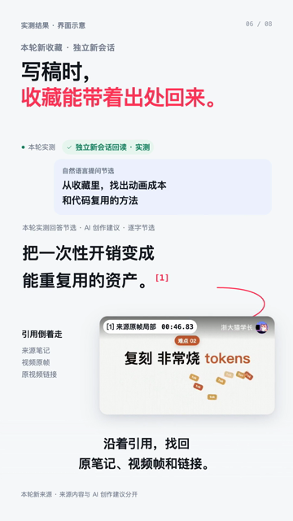

# Source2Brain

让你正在用的 Agent，把收藏变成有出处、用得上的知识。

刷抖音、小红书遇到干货，来不及消化？你可以把链接交给现有 Agent；也可以按可选配方接入微信 ClawBot，让常驻电脑上的 Agent 接着处理。整理结果保存在普通 Markdown 文件夹，下一次写稿、做方案时，再带着出处找回来。

**当前版本：[v0.2.0](https://github.com/lorinefeng/Source2Brain/releases/tag/v0.2.0)。** 从开发者预览进入按明确范围交付的正式版本：双平台视频采集、可选微信入口、普通文件知识库和按需视觉证据。主要运行实测环境为 **macOS arm64**；各项能力的实测层级见[验证矩阵](docs/v0.2-validation.md)，尚待补齐的工作见[路线图](docs/roadmap.md)。

## 60 秒认识 Source2Brain

[](https://github.com/lorinefeng/Source2Brain/blob/main/media/source2brain-intro-60s.mp4)

**[▶ 播放 60 秒介绍](https://github.com/lorinefeng/Source2Brain/blob/main/media/source2brain-intro-60s.mp4)** · [下载 MP4](https://github.com/lorinefeng/Source2Brain/releases/download/v0.2.0/source2brain-intro-60s.mp4) · [字幕](https://github.com/lorinefeng/Source2Brain/blob/main/media/source2brain-intro-60s.srt)

原 120 秒介绍片按 **2 倍速**压至 60 秒，保留音高与画内字幕。画面中的界面示意和实测范围标注保留；视频展示主线，具体支持程度以验证矩阵为准。

| 把链接发给微信 | 把画面证据补回来 | 下次写稿带着出处用 |
| :---: | :---: | :---: |
|  |  |  |

## 它负责什么

Source2Brain 针对“收藏很多，做事时用不上”的问题，把成熟开源方案整理成 Agent 能执行的配方：识别缺口、检查已有能力、按需安装、调用、映射结果，再保存和回读验证。模型与对话由用户选择的 Agent 宿主提供。

```text
手机分享链接 → 可选微信 ClawBot（OpenClaw 常驻参考路线）
                                 ↓
已有 Agent ──────────→ Source2Brain Skill
                                 ↓
                     查配方 → 复用或补齐工具
                                 ↓
                     原文、口播、按需画面证据
                                 ↓
                     普通 Markdown 文件夹
                                 ↓
                     新会话检索 → 带出处用于工作
```

- **读取内容：** Agent-Reach 提供平台能力检测和采集方法，OpenCLI 复用实际运行电脑的浏览器。小红书使用其现有适配；抖音单条视频由本项目补只读路由，验证状态见矩阵。
- **理解与保存：** 本地 ASR 提供口播文字；用户的 Agent 整理要点。SourceArtifact/SourceEnhancement 校验来源、逐字引文、附件和覆盖范围。
- **补能力：** media 用 summarize 抽帧，优先交给 Agent 自身多模态能力识读；MarkItDown、Karakeep、Anytype MCP 仍是候选。[能力索引](references/extensions/README.md)写明职责、前置条件、调用办法和实测范围。

## 两种安装入口

### 已有 Agent 直接使用

把仓库链接和下面提示词发给你正在使用的 Agent：

> 请读取 https://github.com/lorinefeng/Source2Brain 的 README、当前宿主接入说明和 SKILL.md，为我安装 v0.2.0 的完整 Source2Brain Skill，并核对 Release 的 SHA256SUMS。先确认实际运行机器，检测并复用已有模型、Node、采集工具和本地转写能力；缺失时按项目配方补齐，不修改其他 Agent 的默认模型或配置。知识保存到 `~/SecondBrain`。常驻整理优先使用原生多模态能力；我的主模型只有文本能力时，先检测我指定的视觉工具。平台登录由我在运行电脑完成。安装后用真实链接验证保存，再开独立新会话查回来源；逐项说明哪些通过、哪些仍有缺口。

| 宿主 | 安装与验收入口 | 边界 |
| --- | --- | --- |
| OpenClaw | [安装提示与配置](references/openclaw.md) | 有参考部署；微信是可选通道 |
| Hermes | [安装提示与回读](references/hosts/hermes.md) | 沿用当前模型；可用文件关键词检索，无需安装 OpenClaw |
| WorkBuddy | [本地 Skill 导入指引](references/hosts/workbuddy.md) | 官方资料级，未实装验收 |
| 其他 Agent | [宿主资料索引](references/hosts/README.md) | 按各页实测状态，不宣称全部即装即用 |

完整 Skill 必须包含脚本、`lib/`、配方和安装资源。不要只复制 `SKILL.md`。从 [v0.2.0 Release](https://github.com/lorinefeng/Source2Brain/releases/tag/v0.2.0) 下载 `source2brain-skill-0.2.0.tar.gz` 和 `SHA256SUMS`；源码用户可执行 `node scripts/package-skill.mjs` 构建。

### 可选：手机微信收链接

> 请按 Source2Brain 的微信常驻配方，为我配置手机微信发链接、电脑 Agent 整理的入口。先确认实际运行电脑，复用已有 Source2Brain OpenClaw profile、模型与微信绑定，只补缺少的工具。视频默认处理口播和抽样画面文字；登录与扫码由我本人完成。不要复制其他运行中 Agent 的微信 token。完成后分别核对消息接收、平台采集、保存、结果送达和独立新会话召回；失败时保留原因及重试方法。

执行步骤见[微信常驻配方](docs/wechat-recipe.md)和[安装排障](docs/installation.md)。这条参考路线固定为 **OpenClaw**，不代表 Hermes、WorkBuddy 等都已接通微信。

电脑要保持在线，浏览器登录要有效。建议给 Agent 准备专用平台账号；**OpenCLI 是工具，不是一种账号**。账号和登录态留在实际执行机器，不要在聊天里粘贴 cookies、验证码或密钥。微信扫码仍需本人完成。

## 知识如何保留

每条来源记录原链接、作者与时间（未知为 `null`）、提取原文、真实转写及覆盖限制。AI 摘要、作者观点、模型推断和行动建议分开；作者观点必须有逐字引文。

同一平台 ID 去重。重复发送保留人工编辑；内容变化返回冲突。不完整采集进入 `Pending/`，完整来源进入 `Sources/`。检索仅看 `Sources/`。普通 Markdown 目录就是知识库，Obsidian 可作为阅读器，无需额外数据库。

视频只转写会遗漏画面信息。选择微信视频整理配方后，Agent 会按需准备 media；基础 Skill 安装仍不默认下载所有扩展。media 默认保存的是**抽样帧、视觉识读结果、时间戳与逐字引用**，不是完整视频理解。增强版本追加到原来源下，不覆盖原文和批注；没有足够证据时保留缺口。

**常驻整理推荐：选择原生支持多模态的 Agent / 模型。** 抖音、小红书的图片、课件和视频画面应真实送入视觉模型。文本模型可另接用户指定的视觉工具；没有视觉能力时只保存已完成部分并报告缺口。默认不安装 Tesseract、OCR 语言包或另一套视觉模型。

```sh
node scripts/brain.mjs doctor --store ~/SecondBrain
node scripts/brain.mjs doctor --pack media
# 有画面文字需求且检测未就绪时，显式按需安装（Node 24+）
node scripts/install-media.mjs
node scripts/brain.mjs enhance --pack media --artifact /来源目录/artifact.json --out /新的处理目录
```

Agent 随后按[media 配方](references/extensions/media.md)核对原帧与原转写，保存增强并回读。现有真实结果见[media 历史验收](docs/media-validation.md)；新版验证见[验证矩阵](docs/v0.2-validation.md)。

## 开发与分发

```sh
npm test
npm run release:check
npm run release:build
```

版本包和校验和输出到本地忽略目录，不自动发布。核心脚本使用 Node 内置模块；ASR、media、宿主和浏览器扩展按需求独立准备。模型、媒体、私人验收资料、账号与密钥不随包分发。

本参考部署由 MacBook 维护源码与安装经验，Mac mini 常驻运行。其他用户可以在同一台机器完成这些职责。OpenClaw/微信只是其中一条部署路线；宿主兼容服务于按需组合工具的主线。

[贡献说明](CONTRIBUTING.md) · [安全说明](SECURITY.md) · [版本记录](CHANGELOG.md) · [上游致谢](THIRD_PARTY_NOTICES.md) · [依赖角色](integrations.yaml) · [MIT](LICENSE)
